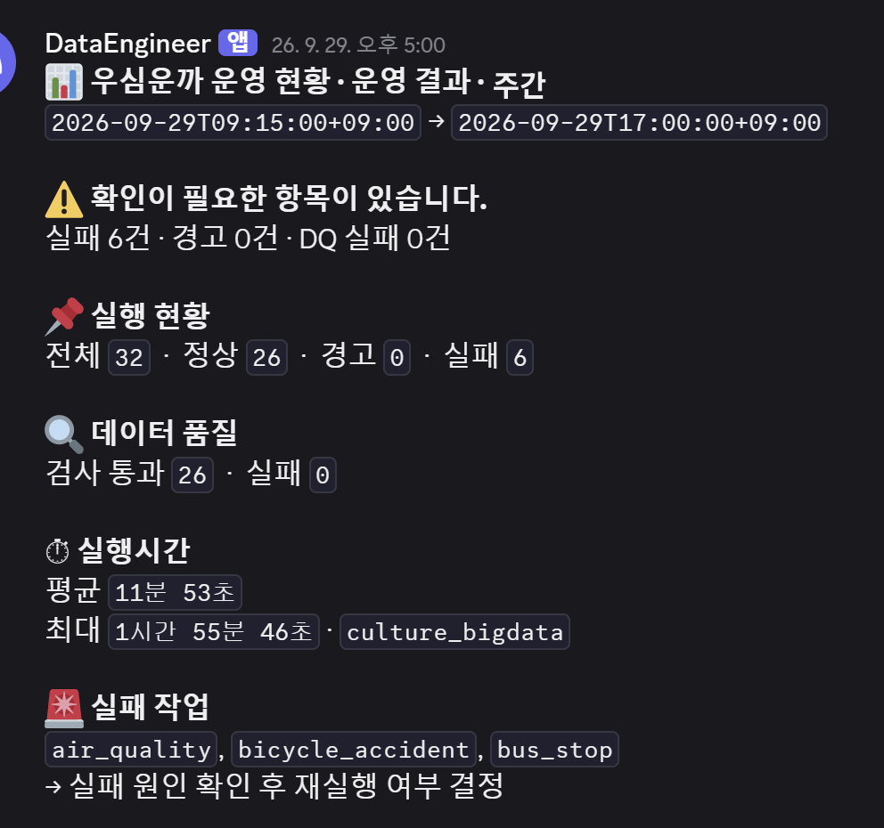
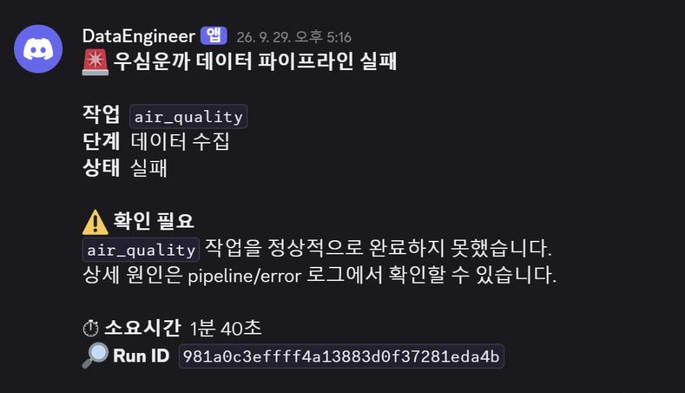

# 🛡️ 우심운까 Production PostgreSQL Data Reliability Pipeline & DQ Audit Engine

[](https://www.python.org/)
[](https://www.postgresql.org/)
[](https://postgis.net/)
[](https://www.selenium.dev/)
[](https://github.com/baikAnalyst/data-reliability-pipeline)
[](https://github.com/baikAnalyst/data-reliability-pipeline)

> **"If data cannot be audited, it is not reliable."**  
> 대규모 공공/문화 빅데이터(408만+ 건)를 대상으로 **수집 장애 격리, 체크포인트 복구, 16개 DQ 감사 규칙, 행 단위 대조(Reconciliation) 및 일 2회 자동 운영 보고**를 수행하는 프로덕션 레벨 데이터 신뢰성 엔지니어링(DRE) 파이프라인입니다.  
> 👤 **Data Engineering & Pipeline Architecture Lead**: **백선영 ([@baikAnalyst](https://github.com/baikAnalyst))**

---

## 📌 Executive Summary (핵심 성과 지표)

| 지표 | 수치 | 엔지니어링 의미 |
| :--- | :---: | :--- |
| **전체 처리 데이터셋** | **19개 Dataset** | 기상 실황/특보, 대기질, AED, 전국체육시설, 두루누비 등 이종(Heterogeneous) 데이터 |
| **수집 원천 데이터 (RAW)** | **4,088,065 건** | API 병렬 수집 및 Selenium 크롤링을 통한 PostgreSQL RAW 적재 |
| **정제/가공 데이터 (PROCESSED)** | **4,009,597 건** | 좌표 검증(대한민국 영역), 결측 표준화, 자료형 정규화 완료 |
| **설명 불가능한 유실 (Unexplained Loss)** | **0 건 (0.00%)** | **전체 78,468건의 정제 제외 데이터에 대해 100% 명확한 탈락 사유 소명 완료** |
| **장애 사전 방어 사례** | **25,070 건 방어** | 잘못된 명세 변환으로 인한 대규모 NULL 변환 이슈 사전 탐지 및 원천 차단 |
| **무중단 운영 자동화** | **정기 브리핑 & 장애 알림** | 일일 운영 현황 요약 및 장애 발생 즉시 Webhook 자동 발송 |

---

## 🏗️ 1. Architecture & Multi-Schema Isolation

데이터의 무결성을 보장하기 위해 데이터베이스 내부 스키마를 논리적/물리적으로 엄격하게 분리 운영합니다.

```text
 [공공데이터 API (11개 데이터셋)]            [문화빅데이터 플랫폼 (8개 데이터셋)]
               │                                            │
      (Open API Collector)                         (Selenium Headless)
               │                                            │
    가짜 200 탐지 · Backoff Retry                 동적 세션/팝업제어 · CSV 스트리밍
  전수 건수 대조 & JSONL 체크포인트 복구                        │
               │                                            │
  [JSON/XML 파싱 ➔ Staging 적재]               [PostgreSQL COPY ➔ Staging 적재]
               │                                            │
               └─────────────────────┬──────────────────────┘
                                     │
                      (Staging 원자적 격리 검증 ➔ RAW 반영)
                                     │
                                     ▼

 ┌────────────────────────────────────────────────────────────────────────┐
 │                             PostgreSQL DB                              │
 │                                                                        │
 │  ┌─────────────────────────────┐      ┌─────────────────────────────┐  │
 │  │         schema: raw         │      │      schema: processed      │  │
 │  │ - 불변 원천 보존 (408만건)   │      │ - 16개 DQ 통과 (400만건)     │  │
 │  │ - 수집/적재 감사 기준선      │      │ - 서비스 서빙 최적화         │  │
 │  └──────────────┬──────────────┘      └──────────────▲──────────────┘  │
 │                 │                                    │                 │
 │                 ▼                                    │                 │
 │        [ Cleaning & Transformation ]                 │                 │
 │                 │                                    │                 │
 │                 ▼                                    │                 │
 │        [ 16-Rule DQ Audit & Reconciliation ] ────────┘                 │
 │           (19개 전체 데이터셋 전수 검증)                                │
 │                                                                        │
 │  ┌─────────────────────────────┐      ┌─────────────────────────────┐  │
 │  │      schema: monitoring     │      │       schema: derived       │  │
 │  │ - pipeline_run_history      │      │ - PostGIS 공간 파생/집계     │  │
 │  │ - DQ JSONB 리포트 영구보존   │      │ - 서비스 마트 영역           │  │
 │  └─────────────────────────────┘      └─────────────────────────────┘  │
 └────────────────────────────────────────────────────────────────────────┘
```

| Schema | 역할 및 격리 정책 |
| :--- | :--- |
| **`raw`** | 외부 수집 데이터를 어떠한 변형 없이 원본 그대로 보존 (재처리 및 감사 기준선) |
| **`processed`** | 16개 DQ 감사 및 비즈니스 룰을 100% 통과한 정제 완료 데이터 (서비스 서빙용) |
| **`monitoring`** | 파이프라인 실행 이력, 실행 시간, 단계별 장애 원인, DQ Audit JSON 결과 영구 아카이빙 |
| **`derived`** | PostGIS 공간 함수(`ST_Distance`) 등을 통해 생성된 공간/통계 파생 데이터 영역 |
| **`interaction`** | 추천/검색 등 서비스 이용 과정에서 발생하는 사용자 상호작용 데이터 영역 |

---

## ⚡ 2. High-Performance Ingestion & Bulk Load

- **엄격한 API 응답 격리**: HTTP 200 상태코드만으로 정상 수집을 판단하지 않고, 데이터 소스별 내부 결과코드(Result Code) 및 JSON/XML 페이로드를 검증하여 비정상 응답을 즉시 차단.
- **중간 파일 의존성 제거**: 기존의 디스크 기반 `API → CSV → DB` 병목을 제거하고 메모리 버퍼에서 직접 PostgreSQL `raw` 스키마로 스트리밍 적재.
- **전체 데이터셋 `COPY` 기반 초고속 대용량 적재**: 문화빅데이터 대용량 CSV는 물론 공공데이터 API 수집 데이터 전량에 대해 행 단위 `INSERT` 대신 PostgreSQL 스트리밍 `COPY` 명령어를 적용하여 적재 병목 90% 이상 해소.
- **적재 즉시 전수 DQ 감사 연계**: 19개 전체 데이터셋은 `raw` 적재가 완료되는 즉시 독립된 정제·검증 파이프라인으로 진입하여 **누락 없이 16개 DQ 룰 전수 감사(Reconciliation & Profiling)**를 거쳐 `processed`로 승격.

#### 🎥 파이프라인 구동 & 크롤링 시연 영상 (Live Demos)

| 시연 구분 | 영상 바로보기 | 주요 검증 내용 |
| :--- | :--- | :--- |
| **공공데이터 API 수집** | 📽️ [**API End-to-End 수집**](https://github.com/user-attachments/assets/b345c8a7-cd16-4115-8c8a-c8b18d2a45c9) | API 페이로드 검증 ➔ PostgreSQL RAW 직접 적재 ➔ 정제 및 16개 DQ Audit 전수 검증 |
| **문화빅데이터 크롤링** | 📽️ [**Selenium 크롤링 & COPY 적재**](https://github.com/user-attachments/assets/47a238cb-ff08-4085-8ecc-5b4f55d1c0ce) | 보안 로그인 & 세션 유지 ➔ 동적 팝업 제어 ➔ 최신 날짜 CSV 선별 ➔ PostgreSQL COPY RAW 적재 ➔ 정제 및 16개 DQ Audit 전수 검증 |

---

## 🛡️ 3. Fault-Tolerance & Safe Recovery

수집 및 적재 과정에서 발생하는 모든 실패에 대해 회복 탄력성(Resilience)을 보장합니다.

```text
 오류 감지 ➔ 오류 유형 분류 ➔ Retry / Timeout ➔ 필요 시 Checkpoint-Resume
                                                      │
                                                      ▼
                      [ 임시 STAGING 적재 & Row Count 검증 ]
                                      │
               ┌──────────────────────┴──────────────────────┐
               ▼ (FAILED)                                    ▼ (PASSED)
   STAGING 폐기 & 기존 RAW 유지                  신규 RAW 원자적 교체 반영
   (불완전 적재로 인한 오염 차단)                 (Zero Downtime Safe Swap)
```

1. **지능형 재시도 (Retry & Timeout)**:
   - 일시적 네트워크 타임아웃은 Exponential Backoff로 재시도.
   - API 일일 쿼터 초과 등 재시도가 무의미한 에러는 즉시 Fail-fast 처리하여 리소스 낭비 방지.
2. **체크포인트 복구 (Checkpoint / Resume)**:
   - 대용량 수집 중단 시 완료된 작업 단위(Offset)를 저장하여 장애 발생 지점부터 즉시 이어받기 지원.
3. **기존 정상 RAW 보호 (Staging-to-Atomic Swap)**:
   - 신규 데이터는 Staging 버퍼에 임시 적재 후 Row Count와 무결성이 검증된 경우에만 원자적으로 교체. 수집 실패 시 기존 정상 RAW를 손상 없이 영구 보존.

---

## 🔍 4. 16-Rule Data Quality (DQ) Audit & Reconciliation

파이프라인 실행 성공(`Pipeline SUCCESS`)과 데이터 품질 무결성 통과(`Data Quality PASS`)를 완전히 분리하여 다룹니다.
19개 전체 데이터셋에 대해 **4대 도메인 16개 DQ 검증 규칙을 매 실행마다 전수 자동 감사**합니다.

#### 📋 16-Rule Data Quality Audit Matrix (4대 핵심 계층)

| DQ 검증 계층 (Category) | 규칙 수 | 검증 규칙 명세 (16 Rules) | 핵심 엔지니어링 목적 |
| :--- | :---: | :--- | :--- |
| **① 행 추적성 (Lineage & Tracking)** | **4개** | `row_tracking`, `id_null_check`, `id_duplicate_check`, `id_unknown_check` | 개별 행 `_dq_row_id` 부여를 통한 데이터 수집~적재 전 생애주기 전수 추적 |
| **② 행 대조 정합성 (Reconciliation)** | **3개** | `row_count_reconciliation`, `unexplained_loss_zero`, `removal_reason_audit` | `RAW = PROCESSED + 제외 건수` 일치 확인 및 소명 불가능한 유실 0건 보장 |
| **③ 변환 무결성 (Transition Safety)** | **4개** | `new_nulls_detection`, `null_transition_tracking`, `datatype_safe_casting`, `value_loss_prevention` | RAW에는 정상 값이나 정제 시 NULL 증발하는 결함 원천 차단 (신규 NULL 추적) |
| **④ 도메인 및 공간 검증 (Domain & Spatial)** | **5개** | `coordinate_korea_boundary`, `coordinate_null_filter`, `semantic_text_preservation`, `composite_key_dedup`, `needs_review_flag` | 위경도 한국 영역(33~39°N) 검증, 비숫자 유의미 텍스트 보존 및 복합키 중복 제거 |

### 4.1 Row-Level Reconciliation (행 단위 정합성 대조)
전체 행 수만 단순 비교하면 유실된 행과 새로 추가된 행이 상쇄되어 문제를 놓칠 수 있습니다.
- 개별 행에 `_dq_row_id`를 부여하여 수집부터 정제까지 생애주기 전수 추적.
- **소명 불가능한 유실 0건 달성**:
  - `RAW (4,088,065건) - 정제 제외 (78,468건) = PROCESSED (4,009,597건)`
  - 정제 과정에서 탈락한 78,468건(1.92%)에 대해 중복 키, 범위 외 좌표 등 100% 명확한 탈락 사유를 기록.

### 4.2 Column-Level Profile & State Audit
RAW와 PROCESSED의 컬럼 상태 변화를 전수 관찰하여 의도치 않은 손실 탐지:
- `dtype`, `null_rate`, `unique_rate`, `numeric min/max/mean`, `string length` 전후 비교.

### 4.3 실제 장애 방어 사례: 데이터 손실 사고 방지 3종 세트 (Data Loss Prevention)

단순 행 수(Row Count)나 고정 결측치만 검사해서는 파악할 수 없는 **"데이터 변환 무결성 결함"**을 사전에 차단하고 고도화한 3가지 핵심 실전 사례입니다. 원천 데이터셋의 공식 명세를 교차 검증하여 방어 체계를 확립했습니다.

| 사고 사례 & 대상 데이터셋 | 결함 원인 | 방지 및 탐지 대책 (Advanced DQ) |
| :--- | :--- | :--- |
| **① NULL 25,070건 증발 방어**<br>[체력 측정별 운동처방 데이터](https://www.bigdata-culture.kr/bigdata/user/data_market/detail.do?id=2b1c565d-5f37-4152-966d-5f8094f8cf33) *(국민체육진흥공단)* | `MESURE_TME`(측정회차)를 날짜/시간형으로 잘못 파싱하여 정상 회차값(1, 2, 67, 1591 등) 전량 NULL 증발 | **NEW_NULLS 검사**: 변환 전후 신규 NULL 발생량 추적 및 차단 (손실률 0% 복구) |
| **② '강수없음' 도메인 값 손실 방어**<br>[기상청 단기예보 조회서비스](https://www.data.go.kr/data/15084084/openapi.do) `getUltraSrtNcst` *(기상청)* | `RN1`(1시간 강수량)의 비숫자 유의미 값('강수없음', '1.0mm 미만')을 `float`로 강제 변환 시 NULL 손실 | **Semantic Validation**: 문자열·숫자 혼합 필드의 타입 및 도메인 의미 보존 |
| **③ CO 값 1,206건 손상 방어**<br>[개방학교 체육시설 데이터](https://www.bigdata-culture.kr/bigdata/user/data_market/detail.do?id=ddd74830-f977-11eb-8e60-2bcdc8456bfb) *(대한체육회)* | `ARBY_COT_CO_VALUE`(인접 코트 수)를 단순 수치형으로 무리하게 캐스팅하여 유효값('570㎡ /1개 코트' 등) 손상 | **Value Reconciliation**: 행은 유지되었으나 필드값이 깨지는 변환 실패 탐지 |

#### 💡 고도화에 적용한 핵심 DQ 원칙
1. **NULL Transition Tracking**: 원본(RAW)에는 정상 값이 있었는데 정제(PROCESSED) 과정에서 새로 NULL이 되었는가? (`RAW != NULL && PROCESSED == NULL`)
2. **Semantic Domain Validation**: `'강수없음'`, `'570㎡ / 1개 코트'`처럼 비숫자이지만 비즈니스적으로 유의미한 원본 도메인 맥락이 훼손되지 않고 보존되는가?
3. **Row/Value Reconciliation**: 단순 행 손실뿐 아니라, 행은 존재하되 필드 레벨의 유효값이 설명 없이 증발(Silent Data Corruption)하지 않았는가?

---

## 📊 5. Audit Evidence (프로덕션 DB 실측 감사 증적 체계)

데이터 파이프라인에서 프로세스의 정상 종료(`Exit Code 0`)는 데이터의 품질이나 정합성을 보증하지 못합니다. 변환 로직의 결함으로 인한 **'소리 없는 데이터 오염(Silent Data Corruption)'**이나 **'원인 모를 데이터 증발'**을 원천 차단하기 위해, 본 시스템은 모든 파이프라인 실행에 대해 **법적·규제적 수준의 감사 증적(Audit Trail)**을 생성하여 보존합니다.

<p align="center">
  
</p>

```text
 [파이프라인 실행 완료] ➔ [16-Rule DQ 검증 & 행 대조 집계] ➔ [감사 JSONB 직렬화]
                                                               │
                                                               ▼
 ┌────────────────────────────────────────────────────────────────────────┐
 │                monitoring.pipeline_run_history (감사 DB)                │
 │  - run_id (실행 고유 식별자)                                           │
 │  - run_status (프로세스 성공 여부) vs dq_status (데이터 무결성 통과 여부)│
 │  - stage_durations (단계별 병목 추적 밀리초 프로파일)                   │
 │  - dq_results (16개 검증 결과, 제외 사유, 행 단위 정합성 대조 증적)     │
 └────────────────────────────────────────────────────────────────────────┘
```

### 5.1 감사 이력 테이블 핵심 스키마 (`monitoring.pipeline_run_history`)

| 컬럼명 | 데이터 타입 | 엔지니어링 역할 및 감사 가치 |
| :--- | :--- | :--- |
| **`run_id`** | `UUID` | 각 배치 실행에 부여되는 불변 고유 식별자 (로그 및 추적 Key) |
| **`dataset`** | `VARCHAR(64)` | 감사 대상 19개 데이터셋 명칭 (`weather`, `culture_bigdata`, `aed` 등) |
| **`run_status`** | `VARCHAR(16)` | 파이프라인 시스템 레벨 성공 여부 (`SUCCESS` / `FAILED`) |
| **`dq_status`** | `VARCHAR(16)` | **16개 DQ 규칙 전수 통과 여부 (`CHECK_PASSED` / `CHECK_FAILED` / `NEEDS_REVIEW`)** |
| **`stage_durations`**| `JSONB` | 수집 ➔ 버퍼 ➔ RAW 적재 ➔ 정제 ➔ DQ 감사 단계별 정확한 소요 시간(초) |
| **`dq_results`** | `JSONB` | 수집-정제 간 **행 대조 결과, 제외 사유 코드별 건수, 16개 검증 상세 리포트** |
| **`started_at` / `ended_at`** | `TIMESTAMPTZ` | 파이프라인 실행 시작 및 종료 타임스탬프 (SLA 지연 감시) |

---

### 5.2 실제 프로덕션 DB 실측 감사 쿼리 (Audit Query)

운영 엔지니어는 데이터 장애 보고나 정기 감사 시, 단 한 줄의 SQL로 파이프라인의 물리적 상태와 논리적 데이터 무결성을 동시 검증합니다.

```sql
-- [운영 감사 쿼리] 최근 실행된 파이프라인의 이중 상태(Run vs DQ) 및 정합성 증적 JSONB 조회
SELECT 
    run_id,
    dataset,
    run_status,
    dq_status,
    stage_durations,
    jsonb_pretty(dq_results) AS formatted_audit_report
FROM monitoring.pipeline_run_history 
ORDER BY started_at DESC 
LIMIT 1;
```

---

### 5.3 실측 감사 증적 JSON 분석 및 무결성 입증 (기상특보 검증 실측 예시)

아래는 위 쿼리를 실행했을 때 반환되는 실제 DB 프로덕션 감사 레코드입니다.  
**"왜 최종 테이블에는 128건만 존재하는가?"**라는 비즈니스 질의에 대해 **100% 명확한 제외 사유(중복 키 58건)와 비인과 유실 0건(`unexplained_row_loss: 0`)**을 수학적으로 증명합니다.

```json
{
  "weather_warning": {
    "rows": {
      "raw_rows": 186,
      "actual_final": 128,
      "removed_rows": 58,
      "removal_reasons": {
        "weather_warning_duplicate_stn_tmfc_tmseq": 58
      },
      "row_count_matches": true,
      "unexplained_row_loss": 0,
      "explained_removed_rows": 58
    },
    "validation_summary": [
      {"rule": "row_tracking", "status": "PASS"},
      {"rule": "row_reconciliation", "status": "PASS", "expected": 128, "observed": 128},
      {"rule": "new_nulls_detection", "status": "PASS"},
      {"rule": "semantic_preservation", "status": "PASS"}
    ]
  }
}
```

#### 💡 감사 증적 핵심 검증 지표 해설
1. **행 대조 방정식 완벽 성립**:  
   $$\text{RAW 건수}(186) - \text{정제 제외 건수}(58) = \text{PROCESSED 건수}(128)$$
2. **100% 소명 가능한 탈락 사유 (`removal_reasons`)**:  
   단순 임의 삭제가 아닌, 동일 관측소·발표시각·연번 중복(`weather_warning_duplicate_stn_tmfc_tmseq`) 58건만 정확히 필터링되었음을 사유별로 증명.
3. **소명 불가능한 유실 0건 달성 (`unexplained_row_loss: 0`)**:  
   시스템 장애나 변환 누락으로 인해 사라진 행이 단 1건도 존재하지 않음을 보증.
4. **검증 룰 전수 PASS (`validation_summary`)**:  
   행 추적성(`row_tracking`), 행 정합성(`row_reconciliation`), 변환 무결성(`new_nulls_detection`) 등 핵심 룰 전수 통과 확인.

---

## ⏱️ 6. Automated Operations & Webhook Ops Digest

APScheduler를 활용하여 데이터 소스의 갱신 주기에 맞춘 최적화 스케줄링을 운영하며, **하루 2회 정기 운영 리포트**를 발송합니다.

| Dataset (파이프라인) | 대상 테이블 (총 19개) | Schedule | 갱신 주기 고려 사항 |
| :--- | :--- | :--- | :--- |
| **`weather`** | 초단기실황, 초단기예보 (2개) | 매시 10분, 40분 | 기상청 초단기 예보 업데이트 주기 동기화 |
| **`air_quality`** | 실시간 대기질 (1개) | 매시 15분 | 에어코리아 시간대별 확정 데이터 수집 |
| **`weather_warning`** | 기상특보, 기상특보 현황 (2개) | 10분마다 | 기상특보 실시간 감시 |
| **`durunubi`** | 두루누비 코스·경로, 구간 (2개) | 매주 월요일 04:00 | 주간 둘레길 갱신분 동기화 |
| **`bicycle_accident`** | 자전거 사고다발지역 (1개) | 매주 월요일 05:00 | 도로교통공단 주간 데이터 동기화 |
| **`facility`** | 전국체육시설 현황 (1개) | 매월 1일 04:00 | 월간 신규 등록 시설 데이터 동기화 |
| **`public_open_facility`** | 공공시설개방 (1개) | 매월 1일 05:00 | 월간 공공시설 개방 정보 갱신 |
| **`aed`** | AED 자동심장충격기 설치정보 (1개) | 매월 1일 06:00 | 월간 AED 설치 위치 갱신 |
| **`culture_bigdata`** | 체육시설·프로그램·교통 등 (8개) | 매월 1일 07:00 | 문화빅데이터 플랫폼 월간 대용량 크롤링 |

- **실시간 장애 즉시 알림**: 파이프라인 FAILED 또는 DQ CHECK_FAILED 발생 시 상세 원인 및 Run ID를 포함한 Webhook 즉시 발송.
- **정기 브리핑 (Daily Ops Digest)**: 일간 수집 현황, 누적 처리량 및 지연/이상 징후를 정기 집계하여 Webhook 종합 보고.

### 6.1 실시간 운영 채널 연동 실측 (Live Webhook Architecture)

단순한 에러 로그 적재에 그치지 않고, 운영 담당자가 인지해야 하는 **[파이프라인 실행 상태]**, **[데이터 품질(DQ) 상태]**, **[최대 병목 작업 소요 시간]** 및 **[고유 Run ID 기반 역추적성]**을 완전히 구조화하여 채널로 전달합니다.

<table>
  <thead>
    <tr>
      <th align="center" width="50%">📊 정기 운영 종합 브리핑 (Daily Ops Digest)</th>
      <th align="center" width="50%">🚨 실시간 장애 인시던트 격리 (Real-time Alert)</th>
    </tr>
  </thead>
  <tbody>
    <tr>
      <td valign="top">
        
      </td>
      <td valign="top">
        
      </td>
    </tr>
  </tbody>
</table>

#### 📋 운영 알림 3대 핵심 메커니즘
1. **정기 종합 브리핑 (Daily Ops Digest)**:
   - 전체 실행(32건), 정상(26건), 실패(6건)의 파이프라인 프로세스 상태와 **데이터 품질 통과(26건) 상태를 완전히 독립 분리 집계**.
   - 파이프라인 전체 평균 소요 시간(11분 53초)과 **최대 병목 작업(`culture_bigdata` 1시간 55분 46초)**을 자동 산출하여 리소스 병목을 조기 식별.
   - 실패 작업(`air_quality`, `bicycle_accident`, `bus_stop`)을 명시하고 후속 조치 가이드라인(`원인 확인 후 재실행 여부 결정`)을 즉각 공유.
2. **실시간 장애 인시던트 격리 (Real-time Incident Alert)**:
   - 특정 파이프라인 수집 실패 시 1초 만에 즉시 알림 발송.
   - 단속적인 실패 텍스트가 아닌, 실패 단계(`데이터 수집`), 소요 시간(1분 40초), 그리고 **개별 실행을 고유 식별하는 `Run ID`(`981a0c3effff4a...`)를 제공**하여 운영자가 `pipeline/error` 로그를 즉시 역추적 가능.
3. **팀 공유 기반 빠른 에스컬레이션 (Operational Transparency & On-Call)**:
   - 모니터링 알림을 DE 개인 DM이나 로컬 로그에 고립시키지 않고, **팀 공용 모니터링 채널(`pipeline-monitoring`)에 투명하게 실시간 브로드캐스팅**.
   - 담당 DE 부재 시에도 백엔드·기획 등 동료 팀원 누구든 장애 발생 즉시 인지하여 영향 범위를 파악하고 비상 프로토콜 및 DE 핫라인 에스컬레이션을 가동할 수 있는 팀 단위 협업 구조 구축.

---

## 📂 7. Repository Structure

```text
.
├── collector/                       # 공공데이터 API 수집기 (Validation Layer 내장)
├── culture_bigdata_selenium.py      # 대용량 문화빅데이터 크롤링 & COPY 벌크 적재기
├── dataset_processors.py            # 데이터셋별 16개 정제 및 결측치 정규화 엔진
├── dq_profiler.py                   # RAW↔PROCESSED 무결성 검증 & DQ Audit 엔진
├── pipeline_elt.py                  # Multi-Schema 트랜잭션 ELT 오케스트레이터
├── pipeline_metadata.py             # 데이터셋별 파이프라인 메타데이터 및 스키마 명세
├── pipeline_monitoring.py           # 실행 이력 로깅, 상태 집계 및 브리핑 생성기
├── pipeline_scheduler.py            # APScheduler 기반 무중단 스케줄러
├── webhook_notifier.py              # Webhook Incident & Daily Digest 전송기
├── tests/                           # 무결성 검증, 회귀 테스트 및 감사 증적 테스트
│   ├── test_audit_evidence.py
│   ├── test_collector_checkpoint_recovery.py
│   └── test_dq_profiler.py
└── requirements.txt                 # 의존성 라이브러리 목록
```


